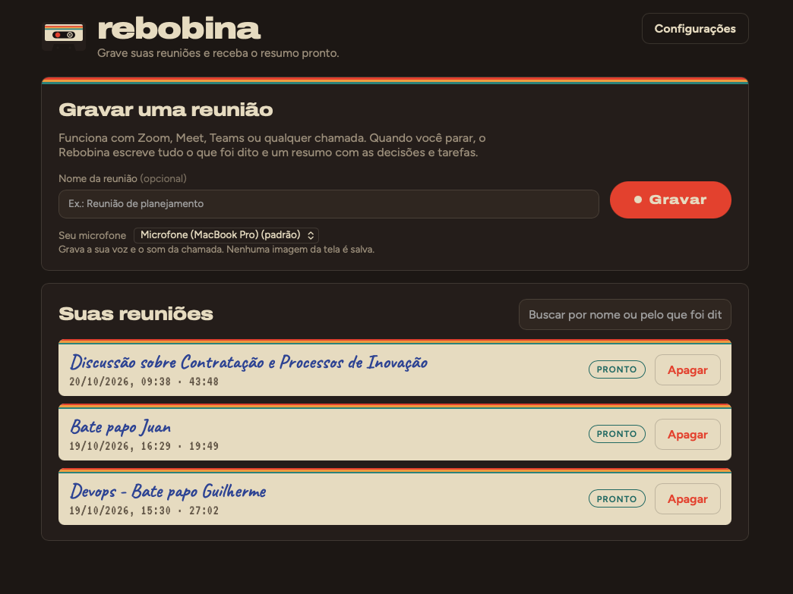
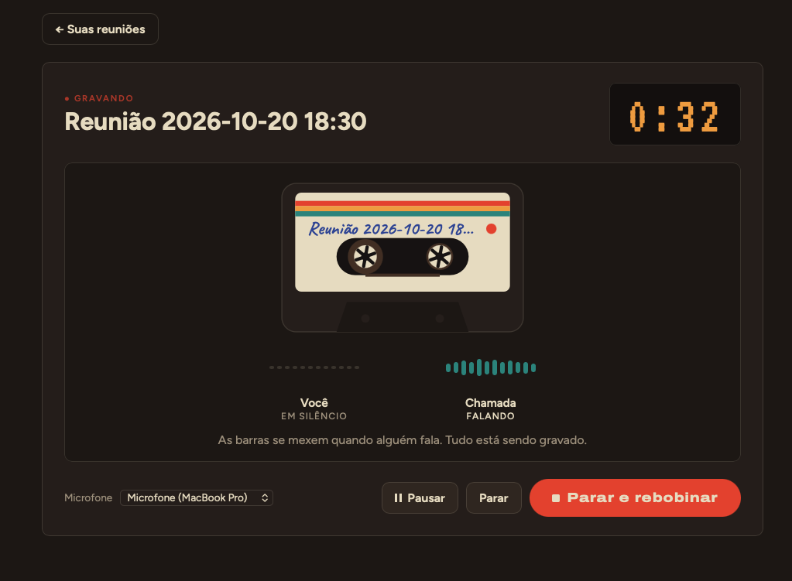

# Rebobina

App macOS para gravar reuniões localmente, transcrever e resumir com IA (OpenAI Whisper + GPT).

Captura **microfone + áudio do sistema** via ScreenCaptureKit — sem bot na call e sem BlackHole.

<p align="center">
  
  
</p>

## Identidade

- **Nome:** Rebobina (antes Gravador). Grava a reunião e depois deixa você voltar ao que importa, como rebobinar uma fita K7.
- **Marca:** fita cassete com o carretel esquerdo em vermelho REC e três listras de etiqueta
- **Paleta:** Fita `#1E1714`, Casco `#2A211C`, Etiqueta `#EADFC6`, REC `#E8402A`, Âmbar `#F2A23A`, Petróleo `#2F8F87`
- **Tipografia:** Archivo Expanded Black (títulos) · Figtree (texto) · VT323 (contador) · Caveat (títulos das fitas)
- **Arquivos:** [`brand/`](brand/) — símbolo, ícone e [guia de identidade](brand/rebobina-identidade.html)

Identificadores: bundle/keychain `dev.vivan.rebobina` (domínio [vivan.dev](https://vivan.dev)), pasta de dados `~/Library/Application Support/rebobina/`. Na primeira abertura o app migra dados/API key legados de `gravador` / `com.vivan.gravador`, se existirem. **É preciso autorizar de novo** Gravação de tela para o novo bundle ID.

## Requisitos

- macOS 13+ (recomendado 15+ para mic via ScreenCaptureKit)
- Node.js 20+
- Rust (stable) — [rustup](https://rustup.rs)
- Xcode.app (ScreenCaptureKit / Swift)
- API key OpenAI

## Como captura o áudio

- Áudio remoto → ScreenCaptureKit (permissão de **Gravação de tela**; sem vídeo salvo)
- Sua voz → microfone

Detalhes: [docs/setup-audio-macos.md](docs/setup-audio-macos.md).

## Desenvolvimento

```bash
cd apps/desktop
npm install
npm run tauri:dev
```

Se o build falhar com erros de Swift:

```bash
sudo xcode-select -s /Applications/Xcode.app/Contents/Developer
```

## Build / instalador (DMG)

```bash
cd apps/desktop
npm install
npm run tauri:build
```

Artefatos:

- `apps/desktop/src-tauri/target/release/bundle/dmg/Rebobina_*.dmg`
- `apps/desktop/src-tauri/target/release/bundle/macos/Rebobina.app`

Abra o `.dmg` e arraste **Rebobina** para Aplicativos. Na primeira abertura (app não assinado / ad-hoc): clique direito → Abrir. Autorize **Gravação de tela**, **Microfone** e **Notificações**, depois **Cmd+Q** e abra de novo.

> **macOS 15+:** captura de áudio do sistema (ScreenCaptureKit) exige build **assinado** com certificado Apple. O DMG ad-hoc das Releases sem `APPLE_CERTIFICATE` pode mostrar Rebobina ligado em Privacidade e mesmo assim recusar a gravação (“usuário recusou os TCCs”). Configure os secrets Apple no Actions para uma release utilizável.

Na raiz: `npm run build`.

## Releases (download do instalador)

O instalador `.dmg` é publicado em [Releases](../../releases) pelo workflow **Release** (`.github/workflows/release.yml`).

### Como publicar uma versão

1. Atualize a versão em `apps/desktop/src-tauri/tauri.conf.json` (e `package.json` se quiser alinhar).
2. Crie e envie uma tag:

   ```bash
   git tag v0.1.0
   git push origin v0.1.0
   ```

   Ou: Actions → **Release** → **Run workflow** e informe a tag (ex. `v0.1.0`).

3. Aguarde o job macOS; o DMG aparece nos assets da release.

Assinatura Apple é **opcional**. Sem secrets, o build usa assinatura ad-hoc. Secrets opcionais: `APPLE_CERTIFICATE`, `APPLE_CERTIFICATE_PASSWORD`, `KEYCHAIN_PASSWORD`, e para notarizar `APPLE_ID` + `APPLE_PASSWORD` + `APPLE_TEAM_ID` (ou API key App Store Connect). Detalhes em [CONTRIBUTING.md](CONTRIBUTING.md#publicar-uma-release).

## Uso

1. Autorize Gravação de tela + microfone
2. Configure a API key em **Configurações**
3. Inicie a gravação (ou aceite a notificação ao detectar uma call)
4. Pare e rebobine — o app transcreve (Lado A, Whisper) e resume (Lado B, GPT-4o)

## Dados locais

`~/Library/Application Support/rebobina/`

(Se você usava a pasta antiga `gravador`, ela é migrada automaticamente na primeira abertura.)

## Contribuindo

Quer ajudar? Veja [CONTRIBUTING.md](CONTRIBUTING.md) para setup, branch, commits e expectativas de PR/CI.

## Licença

[MIT](LICENSE) — Copyright (c) 2026 Marivaldo Vivan
